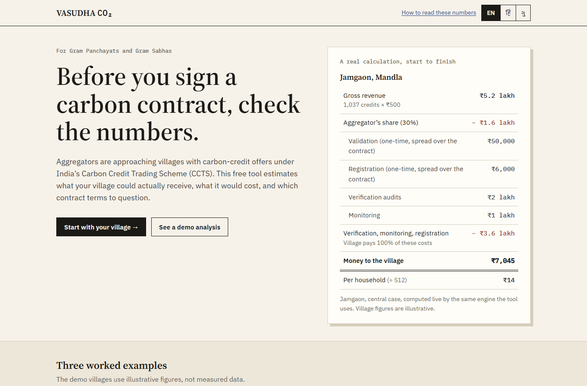
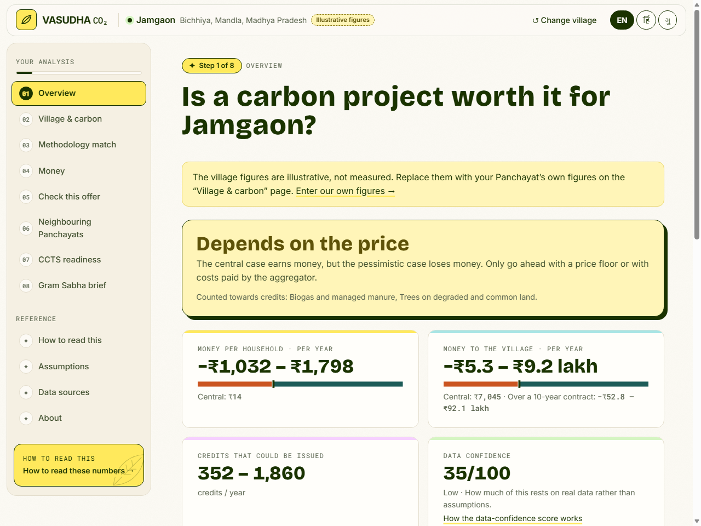
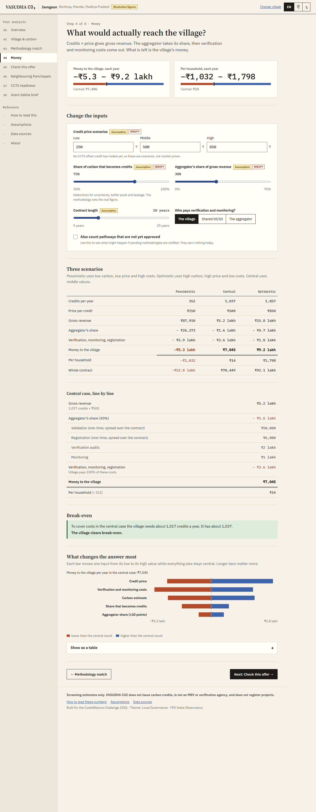
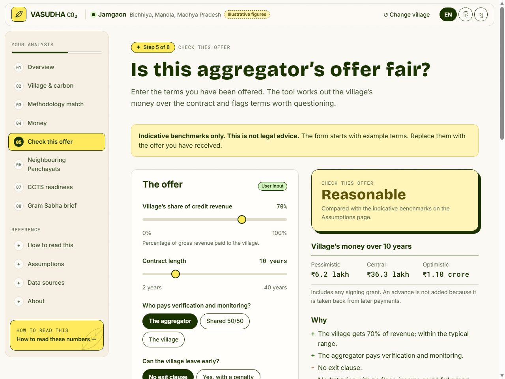
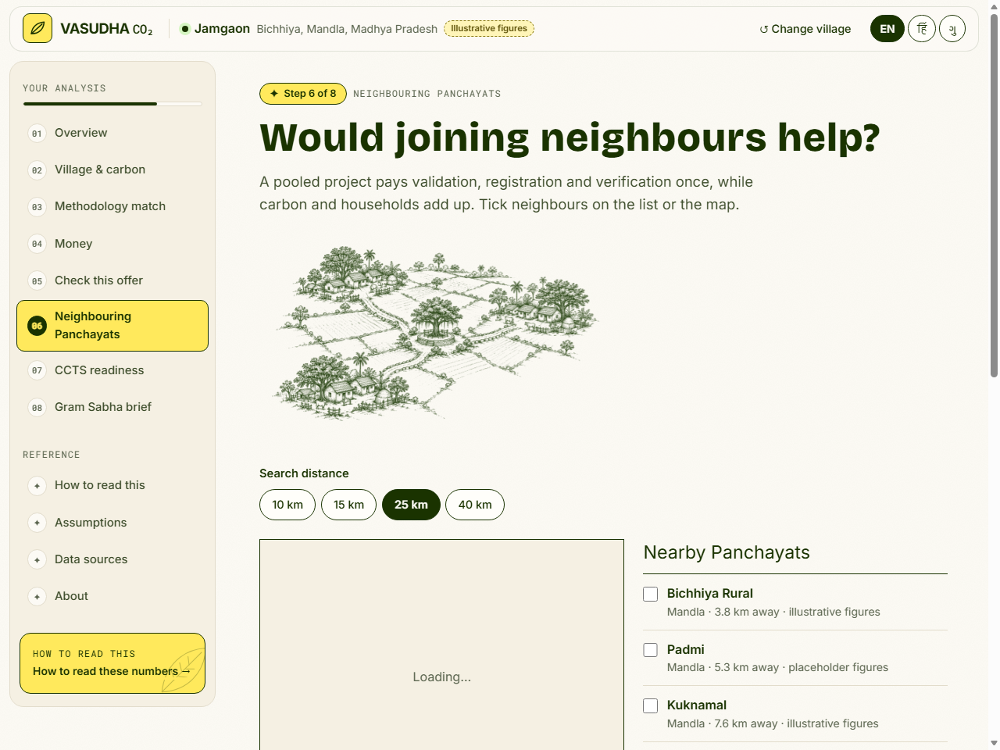
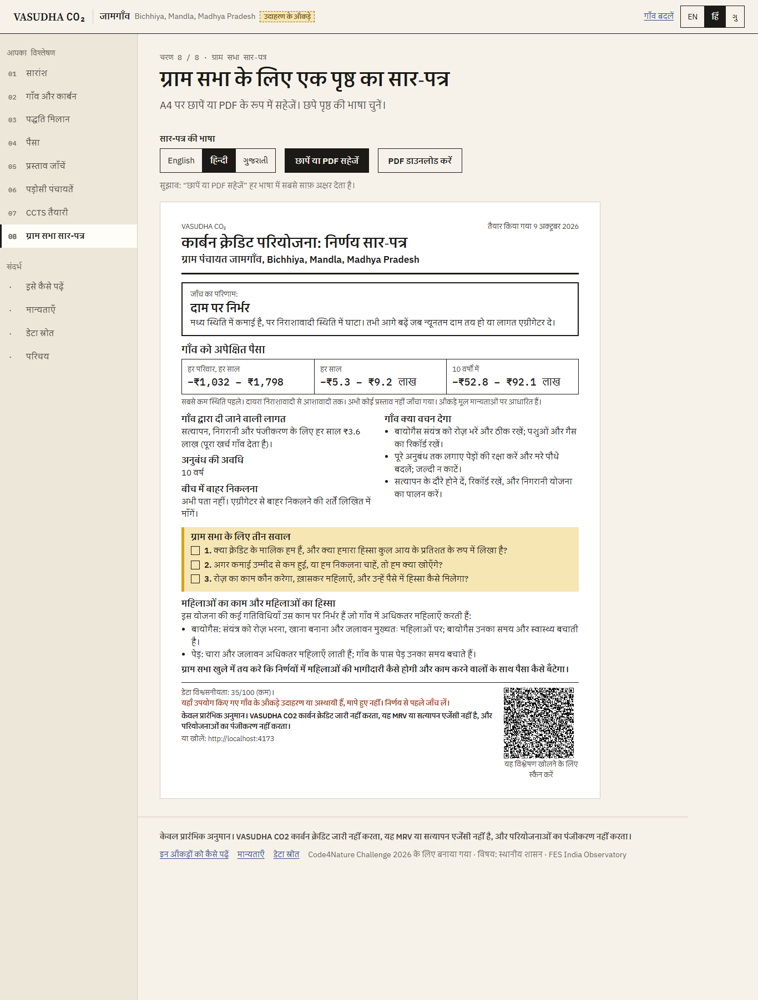
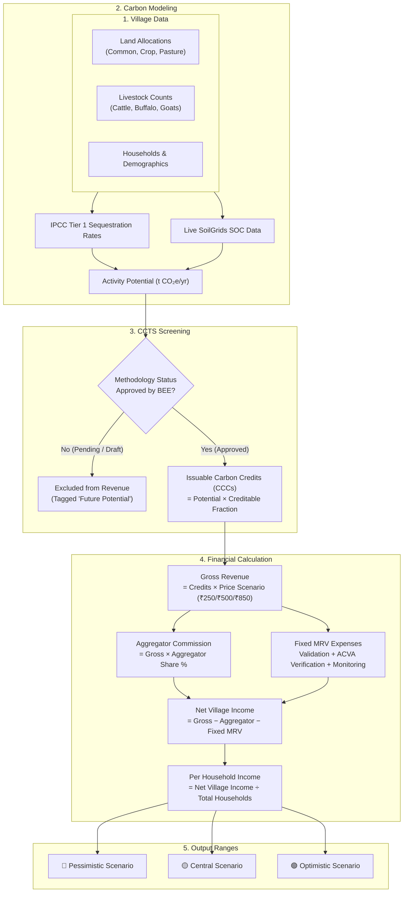

<div align="center">


# 🌾 VASUDHA CO₂ (वसुधा)
### *Before your Gram Sabha signs a carbon contract, check the numbers.*

**A free, trilingual, 100% browser-based screening tool that empowers Indian Gram Panchayats and rural communities to evaluate Carbon Credit Trading Scheme (CCTS) contracts with ruthless economic realism.**

[](https://vasudha-co2.vercel.app/)
[](https://react.dev/)
[](https://www.typescriptlang.org/)
[](https://vitejs.dev/)
[](https://tailwindcss.com/)
[](src/i18n/)
[](src/engine/)
[](https://www.fes.org.in/)

<p align="center">
  🚀 <b>Live App:</b> <a href="https://vasudha-co2.vercel.app/"><b>https://vasudha-co2.vercel.app/</b></a><br/>
  <b>Built for the Code4Nature Challenge 2026</b> · <i>Theme: Local Governance · Foundation for Ecological Security (FES) India Observatory</i>
</p>

[🌐 Visit Website](https://vasudha-co2.vercel.app/) •
[🔍 Core Capabilities](#-key-features--walkthrough) •
[🧮 Mathematical Engine](#-how-the-maths-works) •
[🖼️ Visual Journey](#-interactive-walkthrough--screenshots) •
[🏷️ Provenance & Transparency](#-what-is-real-and-what-is-assumed) •
[💻 Local Setup](#-run-it-locally) •
[🏛️ Project Architecture](#-project-structure)

<br/>



</div>

---

> [!IMPORTANT]
> **Screening estimates only.** VASUDHA CO₂ is designed strictly for independent pre-contract screening and capacity building. It does not issue carbon credits, does not act as an accredited MRV or verification agency, and does not register projects with the Bureau of Energy Efficiency (BEE) or the National Steering Committee for the Indian Carbon Market (ICM). Contract evaluations and offer checks are benchmark-based indicators and **do not constitute legal advice**.

---

## 📌 The Problem: In One Worked Example

Commercial aggregators frequently visit Gram Panchayats pitching lucrative carbon deals based on gross landmass or satellite greenness estimates. But carbon arithmetic at the village scale is unforgiving:

Consider **Jamgaon** (*Mandla District, Madhya Pradesh*):
- **512 households**, **720 hectares**, ~2,000 tonnes of theoretical $\text{CO}_2\text{e}$ sequestered annually on paper.
- Aggregators promise lakhs of rupees in direct annual income.

### What happens when you do the actual math?
1. **Creditable Fraction:** Only specific interventions with formal BEE-approved CCTS methodologies generate issuable credits (often only 70–80% of theoretical biological sequestration).
2. **Aggregator Cut:** Aggregators commonly demand **25% to 50%** of gross credit revenue.
3. **Fixed Transaction & MRV Costs:** Project validation, Bureau registration, accredited ACVA verification audits, and continuous satellite/ground monitoring cost **₹4,00,000 – ₹8,00,000+ per year**, regardless of whether a village has 100 or 1,000 households.
4. **Market Uncertainty:** There is currently no established Indian CCTS voluntary offset floor price.

| Scenario / Assessment | Net Village Income | Per Household / Year | Verdict |
|---|:---:|:---:|:---:|
| **Naive / Aggregator Pitch** (all carbon counted, high price assumption, ignoring fixed costs) | **+₹12,80,000** | **₹2,500** | 🟢 *"Huge windfall"* |
| **VASUDHA CO₂ — Pessimistic Case** (low price ₹250, low adoption, high MRV burden) | **−₹5,28,000** | **−₹1,032** | 🔴 **Net loss to village** |
| **VASUDHA CO₂ — Central Case** (₹500/t, verified methodologies only, realistic audit costs) | **+₹7,200** | **₹14** | 🟡 **Not viable alone** |
| **VASUDHA CO₂ — Pooled Case** (Jamgaon + 4 neighbouring Panchayats sharing audit costs) | **+₹18,40,000** | **₹890** | 🟢 **Viable together** |

> **Key takeaway:** Fixed MRV costs crush isolated villages. An individual Panchayat can easily lose money, yet **pooling together with 3–5 neighbouring Panchayats flips the arithmetic entirely**. VASUDHA CO₂ demonstrates this reality to the Gram Sabha before any binding 20-year agreement is signed.

---

## 🔍 Key Features & Walkthrough

<table>
<tr>
<td width="50%" valign="top">

### 1️⃣ Realistic Village & Carbon Baseline
- **Granular Land Profiling:** Enter village-specific hectares of common lands, pasture, crop area, and livestock head counts.
- **IPCC Tier 1 Emission Factors:** Conservative, verifiable carbon sequestration formulas for Agroforestry, Soil Carbon, Manure Management, and Grassland Restoration.
- **Live ISRIC SoilGrids 2.0 Integration:** Query real-time, satellite-calibrated Soil Organic Carbon (SOC) down to 30 cm depth via live REST API for any coordinate.

</td>
<td width="50%" valign="top">


</td>
</tr>

<tr>
<td width="50%" valign="top">


</td>
<td width="50%" valign="top">

### 2️⃣ Strict CCTS Methodology Filter
- **Verified vs. Pending:** Credits are **only counted if an official methodology is approved**. Unapproved or speculative pathways are tagged as *"Possible in future"* and excluded from revenue totals.
- **Rule-Based Eligibility:** Automatically checks criteria like minimum contiguous land, land tenure legality, and absence of chemical burning.
- **Audit Provenance:** Every factor links back to BEE / IPCC / UNFCCC citations with explicit confidence ratings.

</td>
</tr>

<tr>
<td width="50%" valign="top">

### 3️⃣ Financial Viability & Sensitivity
- **Three-Scenario Forecasting:** *Pessimistic*, *Central*, and *Optimistic* ranges across carbon yield, carbon price (₹250 / ₹500 / ₹850 per tonne), and verification fees.
- **Transparent Ledger:** Line-by-line accounting from Gross Credits $\to$ Aggregator Take $\to$ Third-Party Audit Fees $\to$ Gram Panchayat Corpus $\to$ Net per Household.
- **Tornado Sensitivity Analysis:** Identifies whether the project's bottom line is most vulnerable to carbon price swings, aggregator revenue share, or monitoring overhead.

</td>
<td width="50%" valign="top">


</td>
</tr>

<tr>
<td width="50%" valign="top">


</td>
<td width="50%" valign="top">

### 4️⃣ Panchayat Pooling & Map Integration
- **Break-Even Clustering:** Interactive geospatial MapLibre interface showing nearby Panchayats within an adjustable 5–50 km radius.
- **Shared MRV Economics:** Aggregates land area while sharing validation, baseline measurement, and ACVA audit expenses.
- **Collective Bargaining:** Turns non-viable solitary proposals into economically robust, multi-village cooperative initiatives.

</td>
</tr>

<tr>
<td width="50%" valign="top">

### 5️⃣ "Check This Offer" Contract Analyzer ★
- **Aggregator Contract Audit:** Enter key deal terms (aggregator revenue share %, contract duration in years, signing bonus, MRV cost liability, exit penalty clauses, price floor guarantees, payment schedules).
- **Automated Red Flag Detection:** Flags predatory clauses such as:
  - 🚩 Village bears audit costs while aggregator takes $\ge 30\%$
  - 🚩 Uncapped exclusivity periods ($>15$ years) without price floors
  - 🚩 Surrender of non-carbon land rights or tree tenure
- **Actionable Gram Sabha Questions:** Generates pointed questions the Panchayat committee must ask before signing.

</td>
<td width="50%" valign="top">


</td>
</tr>

<tr>
<td width="50%" valign="top">


</td>
<td width="50%" valign="top">

### 6️⃣ 1-Page Printable Gram Sabha Decision Pack
- **Trilingual Accessibility:** Instantly switch between **English**, **हिन्दी (Hindi)**, and **ગુજરાતી (Gujarati)** with flawless Devanagari and Gujarati typography.
- **Zero-Waste Print Layout:** Automatically formats into a crisp, clean 1-page A4 PDF/print sheet.
- **Specialized Women's Lens:** Highlights impacts on fuel-wood collection rights, forest produce access, and MNREGA daily labor allocations.
- **State Preservation QR Code:** Encodes the entire analysis configuration into a QR code and URL hash for instant resumption without any cloud database.

</td>
</tr>
</table>

---

## 🖼️ Interactive Walkthrough & Screenshots

Here is a look inside the application across key analytical views:

<div align="center">

### 📊 Village Overview & Decision Verdict
*Clear, non-technical verdict, range of net earnings per household, and data confidence rating.*
<br/>


<br/><br/>

### 💰 Financial Breakdown & Tornado Sensitivity Chart
*Pessimistic vs Central vs Optimistic financial ledgers, break-even thresholds, and risk sensitivity.*
<br/>


<br/><br/>

### 📑 "Check This Offer" Aggregator Contract Checker
*Evaluating aggregator terms, detecting predatory red flags, and projecting multi-year revenue share.*
<br/>


<br/><br/>

### 🗺️ Neighbouring Panchayats Geospatial Pooling
*MapLibre GL view showing how grouping neighbouring villages turns losses into substantial shared surplus.*
<br/>


<br/><br/>

### 📜 Official Gram Sabha Decision Brief (हिन्दी / Gujarati / English)
*Print-ready single-sheet brief containing summary figures, red flags, and shareable QR code.*
<br/>


</div>

---

## 🧮 How the Maths Works

VASUDHA CO₂ follows a strict, verifiable calculation pipeline modeled in pure TypeScript in [`src/engine/`](src/engine/):



### Core Mathematical Principles
1. **Always Ranges, Never Point Estimates:** No single number is presented without low, central, and high bands reflecting carbon yield, carbon price, and monitoring expenses.
2. **Never Floor at Zero:** If audit and validation costs exceed credit revenues, the model displays honest negative numbers (e.g. `−₹1,032 / household`).
3. **Break-Even Derivation:** Calculates the exact physical threshold needed to avoid losses:
   $$\text{Break-Even Credits} = \frac{\text{Fixed Annual MRV Costs}}{\text{Carbon Price} \times (1 - \text{Aggregator Share})}$$
4. **Tornado Sensitivity:** Varies each parameter across its $[\text{low}, \text{high}]$ range while holding others constant to uncover the primary driver of project risk.

---

## 🏷️ What is Real and What is Assumed

Every number, constant, and formula in VASUDHA CO₂ is tagged with a transparent provenance indicator:

| Tag | Badge | Meaning | Current Project Source |
|---|:---:|---|---|
| **Dataset** | `Dataset` | Live query against open public data | Real-time REST query to [ISRIC SoilGrids 2.0](https://www.isric.org/explore/soilgrids) |
| **Assumption** | `Assumption` | Transparent parameter with explicit citation | Declared in [`src/config/assumptions.ts`](src/config/assumptions.ts) |
| **User Input** | `User input` | Entered or adjusted by the Panchayat / user | Custom slider, input field, or toggle |

### Data Confidence Score (0–100)
Rather than giving users false certainty, VASUDHA CO₂ computes a composite **Data Confidence Score**:
- Sourced datasets contribute higher confidence.
- Estimated parameters reduce confidence.
- Demo village profiles transparently declare an honest baseline score (~35/100) until verified against local land records.

---

## 🛠️ Tech Stack & Engineering Highlights

- **Framework & Core:** [React 19](https://react.dev/), [TypeScript](https://www.typescriptlang.org/) (Strict Mode), [Vite 8](https://vitejs.dev/)
- **Styling:** [Tailwind CSS v4](https://tailwindcss.com/) with custom high-contrast pastoral earth-tone design system
- **Mapping & Geospatial:** [MapLibre GL](https://maplibre.org/) using OpenStreetMap vector tiles
- **Engine Isolation:** Pure TypeScript engine in [`src/engine/`](src/engine/) with **zero framework dependencies**, thoroughly testable in Node.js
- **Export & Sharing:** [html2canvas](https://html2canvas.hertzen.com/) + [jsPDF](https://github.com/parallax/jsPDF) for client-side vector PDF generation; [qrcode-generator](https://github.com/kazuhikoarase/qrcode-generator)
- **100% Privacy & Zero Backend:** No database, no tracking cookies, no server dependencies. All state is stored locally or encoded in shareable URLs.
- **Ultra-lightweight:** Fast initial bundle (~100 kB gzipped) with lazy code-splitting across every analytical page.

---

## 💻 Run it Locally

### Prerequisites
- [Node.js](https://nodejs.org/) version **20.0.0** or higher
- `npm` or `pnpm`

### Installation & Execution

```bash
# 1. Clone the repository
git clone https://github.com/akshitag001/VASUDHA-CO2.git
cd VASUDHA-CO2

# 2. Install dependencies
npm install

# 3. Start local development server
npm run dev
# Open http://localhost:5173 in your browser

# 4. Run calculation engine tests
npm test

# 5. Run static lint checks
npm run lint

# 6. Build optimized production bundle
npm run build

# 7. Preview the production build
npm run preview
```

---

## 🏛️ Project Structure

```text
VASUDHA-CO2/
├── docs/
│   └── screenshots/              # High-resolution application screenshots
├── public/
│   ├── img/                      # Hand-drawn pastoral sketches & illustrations
│   ├── favicon.svg               # Site branding
│   └── icons.svg                 # SVG sprite sheet
├── src/
│   ├── config/
│   │   └── assumptions.ts        # Central configuration of all economic & carbon assumptions
│   ├── data/
│   │   ├── illustrativeVillages.json  # Reference profiles (Jamgaon, etc.)
│   │   ├── lgd.ts                # Local Government Directory (LGD) codes & coordinates
│   │   ├── methodologies.json    # CCTS sectoral methodologies & screening criteria
│   │   └── regulatory.ts         # Carbon market stakeholder registry
│   ├── engine/                   # PURE TYPESCRIPT CALCULATION ENGINE (No UI code)
│   │   ├── breakeven.ts          # Break-even carbon & land threshold computations
│   │   ├── carbon.ts             # IPCC Tier 1 mitigation formulas
│   │   ├── confidence.ts         # Data confidence index algorithms
│   │   ├── finance.ts            # Revenue, aggregator shares, and net income
│   │   ├── methodology.ts        # Eligibility & compliance rule evaluator
│   │   ├── offer.ts              # Contract benchmarking & red-flag detector
│   │   ├── pooling.ts            # Multi-village pooling aggregation models
│   │   ├── sensitivity.ts        # Tornado risk analysis
│   │   └── engine.test.ts        # Comprehensive Vitest unit tests
│   ├── i18n/                     # Trilingual dictionaries (en.ts, hi.ts, gu.ts)
│   ├── lib/
│   │   ├── exportPdf.ts          # Client-side 1-page A4 PDF rendering
│   │   ├── format.ts             # Currency (₹ Lakhs/Crores) & unit formatters
│   │   └── soilgrids.ts          # ISRIC SoilGrids REST API client
│   ├── model/                    # Adapters binding engine outputs to UI views
│   ├── pages/                    # Code-split analytical views
│   │   ├── Landing.tsx           # Interactive landing page & quick calculation specimen
│   │   ├── Select.tsx            # Village / Panchayat selector
│   │   ├── Overview.tsx          # High-level screening verdict & key metrics
│   │   ├── Carbon.tsx            # Land allocation & biocarbon estimator
│   │   ├── Methodology.tsx       # CCTS methodology compliance checklist
│   │   ├── Money.tsx             # Financial viability, ledger & tornado charts
│   │   ├── Offer.tsx             # "Check this offer" aggregator auditor
│   │   ├── Pooling.tsx           # Geospatial map clustering & multi-village economics
│   │   ├── Readiness.tsx         # Institutional readiness checks
│   │   ├── Brief.tsx             # Printable 1-page Gram Sabha Decision Brief
│   │   └── Assumptions.tsx       # Live assumption editor & inspector
│   ├── state/                    # Local storage state management & URL hash encoder
│   └── ui/                       # Reusable UI primitives, charts, ledger, and layout
├── AUDIT.md                      # Detailed technical audit & design decisions
├── package.json                  # Dependencies and scripts
├── tailwind.config.js            # Tailwind v4 configuration
└── vite.config.ts                # Vite build configuration
```

---

## ⚖️ Limitations & Community Guidance

- **Screening Estimates, Not Investment Prospectuses:** Carbon estimates rely on Tier 1 standard factors. Actual verified credits require accredited onsite sampling, plot demarcations, and Bureau-approved digital MRV.
- **Local Panchayat Authority:** Under PESA (Panchayats Extension to Scheduled Areas Act) and the Forest Rights Act (FRA 2006), Gram Sabhas possess statutory rights over community forest resources. No contract can lawfully alienate community rights or transfer land ownership under the guise of carbon monetization.
- **Pricing Prudence:** Because India's domestic CCTS compliance and offset trading market is actively evolving, revenue models should always be tested against conservative price floors ($\le ₹300/\text{t}$).

---

## 🤝 Roadmap

- [x] Full trilingual UI translation (English, Hindi, Gujarati)
- [x] Pure TypeScript engine with sensitivity and pooling logic
- [x] "Check This Offer" contract red-flag detection system
- [x] Single-page printable Gram Sabha Decision Pack with QR code
- [ ] Direct integration with Official Census 2011 Primary Census Abstract (PCA)
- [ ] Ingestion of 20th Livestock Census datasets for automated herd baselining
- [ ] Addition of regional languages (Marathi, Odia, Telugu)
- [ ] Automatic syncing with Bureau of Energy Efficiency (BEE) official methodology gazettes

---

## 🏆 Acknowledgments & Credits

- **Initiative:** Developed for the **Code4Nature Challenge 2026** under the *Local Governance* theme.
- **Institutional Guidance:** Inspired by the open data and commons governance work of the [Foundation for Ecological Security (FES) India Observatory](https://www.fes.org.in/).
- **Data & Standards:**
  - Soil Data: [ISRIC SoilGrids 2.0](https://www.isric.org/explore/soilgrids) (CC BY 4.0)
  - Emission Factors: IPCC 2006 Guidelines for National Greenhouse Gas Inventories, Vol. 4 (AFOLU)
  - Map Data: © [OpenStreetMap](https://www.openstreetmap.org/) contributors (ODbL)
  - Technical Audit: See [`AUDIT.md`](AUDIT.md) for full calculation validation and evolution history.

---

<div align="center">


<p><b>VASUDHA CO₂</b> · <i>Democratizing Carbon Market Intelligence for India's Gram Panchayats.</i></p>

</div>
