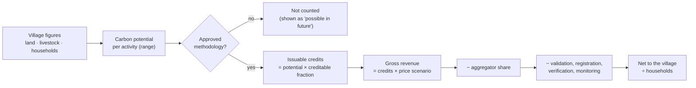

<div align="center">

# VASUDHA CO₂

### Before your Gram Sabha signs a carbon contract, check the numbers.

A free, browser-only screening tool that helps **Gram Panchayats** work out whether joining India's
**Carbon Credit Trading Scheme (CCTS)** is actually worth it, *before* an aggregator's contract is signed.


**Code4Nature Challenge 2026** · Theme: *Local Governance* · FES India Observatory

[What it does](#what-it-does) · [How the maths works](#how-the-maths-works) · [Real vs assumed](#what-is-real-and-what-is-assumed) · [Run it](#run-it-locally)


</div>

> [!IMPORTANT]
> **Screening estimates only.** VASUDHA CO2 does not issue carbon credits, is not an MRV or verification agency, and does not register projects. Offer benchmarks are indicative and are **not legal advice**.

---

## The problem, in one number

Take **Jamgaon** (Mandla, MP): 512 households, about 2,000 tonnes of CO₂ a year of carbon potential on paper. That sounds like a lot of money.

But only some activities have an **approved** methodology. Only part of their carbon becomes **issuable credits**. There is **no CCTS offset market price** yet. The aggregator takes **30%**. And validation, verification and monitoring cost about the same whether a village has 140 households or 650.

| | Money per household per year |
|---|---|
| Previous version of this tool (all carbon counted, high price) | **₹591 – ₹2,546** |
| VASUDHA CO2, central case | **₹14** |
| VASUDHA CO2, full range (pessimistic → optimistic) | **−₹1,032 – ₹1,798** |

Fixed costs dominate at village scale. That's why small villages often lose money alone, and why **pooling with neighbours** can flip the answer. VASUDHA CO2 shows that arithmetic in the Gram Sabha's own language, before anyone signs.

---

## What it does

<table>
<tr>
<td width="50%" valign="top">

**01 · Overview**
A plain verdict: *No approved route yet* · *Not worthwhile on its own* · *Depends on the price* · *Worth exploring*. Money per household as a low–high range, plus a data-confidence score.

**02 · Village & carbon**
Every village figure is editable and tagged. IPCC Tier 1 style carbon potential per activity, shown as a range. Optional **live soil carbon from ISRIC SoilGrids**.

**03 · Methodology match**
A pathway is called **eligible only if its status is approved** and the village meets the screening conditions. Proposed pathways appear separately as *possible in future*.

**04 · Money**
Credits × price → aggregator's share → audit costs → **net to the village**. Three scenarios, a line-by-line ledger, break-even, and a tornado chart.

</td>
<td width="50%" valign="top">

**05 · Check this offer** ★
Enter the aggregator's terms: revenue share, length, signing money, who pays MRV, exit clause, price floor, credit ownership, payment timing. You get **income over the contract, a verdict, red flags and questions to ask**.

**06 · Neighbouring Panchayats**
Tick neighbours on a map or a list. *"Together you clear break-even; alone, none of you do."*

**07 · CCTS readiness**
Five checks computed by the tool, plus a checklist the Panchayat ticks off.

**08 · Gram Sabha brief**
One printable A4 page in **English, हिन्दी or ગુજરાતી**, with a women's-lens section and a QR code that reopens the analysis.

</td>
</tr>
</table>

### A look inside

| Money: three scenarios, ledger, tornado | Check this offer |
|---|---|
|  |  |
| **Pooling neighbours** | **Gram Sabha brief (Hindi)** |
|  |  |

---

## How the maths works



- **Ranges, never single numbers.** The pessimistic case uses low carbon, a low price and high costs; the optimistic case is the reverse. Ranges always read low → high.
- **Nothing is floored at zero.** A negative number means the project costs the village money at that scale.
- **Break-even** is expressed as credits per year, and as the equivalent hectares of new planting or head of cattle.
- **Sensitivity:** a tornado chart shows which assumption moves the answer most: price, aggregator share, creditable fraction, MRV costs, or the carbon estimate.

The engine is pure TypeScript with no React, in [`src/engine/`](src/engine/). Unit tests cover zero credits, costs above revenue, negative income, break-even exactness, pooling and the offer checker.

---

## What is real and what is assumed

Every number in the app carries a tag. Hover over or tap it to see the source and year.

| Tag | Meaning |
|---|---|
|  | Loaded from an open dataset (today: the live **SoilGrids** query) |
|  | A named value in [`src/config/assumptions.ts`](src/config/assumptions.ts), or an illustrative village profile |
|  | Typed in by the user |

**Current state of the data:**

- No dataset file is bundled yet. Census 2011, the 20th Livestock Census, LGD, Bhuvan, MGNREGA, eGramSwaraj and Sentinel-2 are listed in the app as *planned, not loaded*.
- The six demo village profiles and the LGD codes are **illustrative**, and tagged as such.
- Methodology statuses, several emission factors and all cost figures are marked **`VERIFY`** until checked against their sources.
- The **data-confidence score** turns this into a number from 0 to 100. The demo villages score about 35, which is deliberately honest.

---

## Built for the people who will use it

- **Three languages.** All UI strings live in [`src/i18n/`](src/i18n/). Hindi and Gujarati are type-checked against English, so a missing key fails the build, and they load only when chosen.
- **Prints properly.** The brief fits one A4 page in every language. Devanagari and Gujarati print with correct conjuncts.
- **Accessible.** Skip link, visible focus, labelled form controls, a keyboard-friendly map (markers are buttons), a table view for every chart, AA contrast, and no colour-only meaning.
- **Works on a phone**, with a fast first load (about 100 kB gzipped). The map and PDF tools load only when needed.
- **Private by default.** Everything runs in the browser. Inputs are saved locally; share an analysis with a link or the QR code on the brief.

---

## Run it locally

Requires **Node 20+**.

```bash
npm install
npm run dev        # http://localhost:5173
npm test           # engine unit tests (Vitest)
npm run lint       # oxlint
npm run build      # type-check + production build → dist/
npm run preview    # serve the production build
```

No backend, account or paid API. The only network calls are Google Fonts, OpenStreetMap tiles (pooling page only) and SoilGrids (only when you press the button). The repo includes `vercel.json` for one-step deployment.

---

## Project structure

```
src/
├── config/assumptions.ts       ← THE single file of assumptions (value · range · source · year · confidence · verified)
├── engine/                     ← pure, typed calculation engine (no React)
│   ├── carbon.ts               mitigation per activity, ranges from parameter ranges
│   ├── finance.ts              credits → gross → aggregator cut → costs → net
│   ├── breakeven.ts            break-even credits, hectares, cattle
│   ├── sensitivity.ts          tornado analysis
│   ├── pooling.ts              pooled project economics
│   ├── offer.ts                "Check this offer": verdict, red flags, questions
│   ├── methodology.ts          eligible only if approved
│   ├── confidence.ts           data-confidence score
│   └── engine.test.ts
├── data/
│   ├── methodologies.json      rules, status, lastVerified (all VERIFY)
│   ├── illustrativeVillages.json
│   ├── lgd.ts                  Gram Panchayat picker (illustrative codes)
│   └── regulatory.ts           dataset registry, CCTS roles
├── model/                      composes engine + data into an analysis
├── i18n/                       en · hi · gu
├── state/                      persistence + share links
├── ui/                         layout, provenance tags, charts, ledger, map
└── pages/                      one code-split file per page
```

A full audit of the previous version, and how each finding was resolved, is in [`AUDIT.md`](AUDIT.md).

---

## Limitations

- Carbon estimates use simple IPCC Tier 1 style factors and screening adoption shares, not site measurements.
- The demo villages use illustrative figures; real use needs the Panchayat's own figures or loaded datasets.
- Methodology statuses, emission factors and cost figures still need verification.
- Offer benchmarks (for example, a village share below 60% counts as "below typical") are indicative.
- The Hindi and Gujarati translations need review by native speakers.

## Roadmap

- [ ] Load real extracts: Census 2011 PCA, the 20th Livestock Census and LGD for the pilot districts
- [ ] Verify every methodology status against BEE notifications and fill in `lastVerified`
- [ ] Native-speaker review of the Hindi and Gujarati text
- [ ] More Indian languages (Marathi, Odia)

## Credits

Built for the **Code4Nature Challenge 2026** (FES India Observatory).
React · TypeScript · Vite · Tailwind CSS · MapLibre GL · html2canvas · jsPDF · qrcode-generator.
Map data © OpenStreetMap contributors (ODbL) · Soil data: ISRIC SoilGrids 2.0 (CC BY 4.0) · Emission factors: IPCC 2006 Guidelines, Vol. 4.
